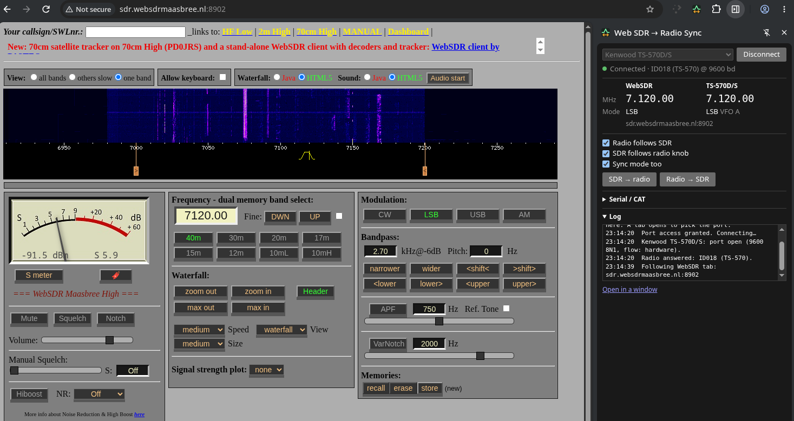

# Web SDR → Radio Sync

A Chrome extension that keeps your transceiver tuned to whatever you're listening to on a web SDR.
Click a signal on a WebSDR, KiwiSDR or OpenWebRX waterfall and your radio follows. It can also work
the other way: turn the VFO knob and the web SDR follows.

It talks to the radio straight from the browser over **Web Serial**, with no helper app, drivers or
rig-control software. Radios without a built-in driver work through **Hamlib** (about 300 models).

- Works with **WebSDR**, **KiwiSDR**, **OpenWebRX** and **OpenWebRX+** pages, detected automatically
- **Built-in drivers** for Kenwood, Elecraft, Yaesu and Icom, plus the many radios that use their protocols
- **Any Hamlib radio** through `rigctld`, or share a `rigctld` that WSJT-X/fldigi already use
- Syncs frequency and mode (LSB/USB/CW/AM/FM). The radio is never retuned while it's transmitting.
- For CW: the radio lands on the signal you hear, not the SDR's BFO frequency
- Optionally keeps your **Cloudlog** or **Wavelog** logbook up to date, so the QSO form is pre-filled
- No tracking or analytics. Data goes only to your radio and, if you set it up, your own logbook.




---

## Contents
- [Supported web SDRs](#supported-web-sdrs)
- [Supported radios](#supported-radios)
- [Installation](#installation)
- [Usage](#usage)
- [Hamlib (any other radio)](#hamlib-any-other-radio)
- [Logbook: Cloudlog / Wavelog](#logbook-cloudlog--wavelog)
- [Cables and serial settings](#cables-and-serial-settings)
- [Troubleshooting](#troubleshooting)
- [How it works](#how-it-works)
- [Development](#development)
- [Privacy](#privacy)
- [License](#license)

## Supported web SDRs

| Software | Example | Notes |
|---|---|---|
| [WebSDR](http://websdr.org/) | http://websdr.ewi.utwente.nl:8901/ | Switches bands automatically |
| [KiwiSDR](http://kiwisdr.com/) | any receiver on [rx.kiwisdr.com](http://rx.kiwisdr.com/) | 0–30 MHz. Keeps your waterfall zoom and honours a transverter frequency offset |
| [OpenWebRX](https://www.openwebrx.de/) / [OpenWebRX+](https://fms.komkon.org/OWRX/) | any receiver on [receiverbook.de](https://www.receiverbook.de/) | Tunes within the band (profile) selected on the page. Pick another profile there to change bands |

Other web SDR software, such as PhantomSDR, isn't supported because it has no JavaScript interface
an extension can use.

## Supported radios

Built-in drivers. Pick the radio in the panel and connect.

| Family | Radios |
|---|---|
| **Kenwood** | TS-50, TS-140, TS-440, TS-450, TS-480, TS-570, TS-590S/SG, TS-680, TS-690, TS-711/811, TS-850, TS-870, TS-890, TS-950, TS-990, TS-2000 |
| **Elecraft** | K2, K3/K3S, K4, KX2, KX3 |
| **Kenwood-compatible** | FlexRadio (SmartSDR CAT), QRP Labs QDX/QMX/QCX, truSDX/uSDX, Lab599 TX-500, SDR software with TS-2000 emulation, any other Kenwood-compatible radio |
| **Yaesu** | FT-450/450D, FT-710, FT-891, FT-950, FT-991/991A, FT-2000, FTDX10, FTDX101D/MP, FTDX1200, FTDX3000, FTDX5000 |
| **Yaesu (5-byte CAT)** | FT-817/818, FT-857, FT-897, FT-847 |
| **Icom (CI-V)** | IC-705, IC-706/MkII/MkIIG, IC-718, IC-735, IC-746/PRO, IC-756PROII/III, IC-910H, IC-7000, IC-7100, IC-7200, IC-7300, IC-7410, IC-7600, IC-7610, IC-7700, IC-7800, IC-7851, IC-9100, IC-9700, IC-R75, IC-R8600, any other CI-V radio (set the address) |
| **Xiegu (CI-V)** | G90, X6100, X5105 |

Everything else that [Hamlib](https://hamlib.github.io/) supports (Ten-Tec, Alinco, AOR, older
Yaesu like the FT-1000MP, and many more) works through [the Hamlib option](#hamlib-any-other-radio).

> The built-in drivers were tested against simulated radios and a real TS-570D. If your radio
> misbehaves, please open an issue, and use the Hamlib option in the meantime.

## Installation

Requires Chrome, Edge, Brave or another Chromium browser, version 116 or later. Firefox and Safari
don't support Web Serial.

1. Download the latest `web-sdr-radio-sync-<version>.zip` from the
   [Releases](../../releases) page and unpack it, or clone this repository.
2. Open `chrome://extensions` and turn on **Developer mode** (top right).
3. Click **Load unpacked** and select the unpacked folder (the one containing `manifest.json`).
4. Pin the extension to the toolbar.

**Linux:** your user needs access to serial ports. Add yourself to `uucp` (Arch, Manjaro,
CachyOS) or `dialout` (Debian, Ubuntu, Fedora), then log out and back in:
```sh
sudo usermod -aG uucp $USER     # or: sudo usermod -aG dialout $USER
```

## Usage

1. Click the extension icon. The sync panel opens in the side panel.
2. Choose your **Radio**. Its usual baud rate, stop bits, handshake and CI-V address are filled in.
   Check them under **Serial / CAT** against your radio's menu.
3. Click **Connect…** and pick the serial port. Chrome doesn't show the port chooser inside
   the side panel, so a tab opens for it. Once you've picked a port, the panel reconnects to it
   automatically next time.
4. Open a WebSDR, KiwiSDR or OpenWebRX page. The panel shows the SDR's frequency next to the radio's,
   and the radio follows as you tune.

| Option | What it does |
|---|---|
| **Radio follows SDR** | The main feature |
| **SDR follows radio knob** | Turning the VFO knob retunes the SDR (within the range that receiver covers) |
| **Sync mode too** | Also sets LSB/USB/CW/AM/FM |
| **SDR → radio / Radio → SDR** | Copy the frequency once in either direction |
| **Offset (Hz)** | Fixed correction (radio − SDR) if the two disagree slightly |
| **Open in a window** | Moves the panel into its own window |

The radio's frequency turns amber when it isn't where the SDR is, for example with sync off, out of
range, or while transmitting.

With several SDR tabs open, the panel follows the tab you're looking at.

## Hamlib (any other radio)

For radios without a built-in driver, choose **Hamlib (rigctld): any supported radio**. A small
helper program starts Hamlib's `rigctld` for your radio and relays frequency, mode and PTT. Browsers
don't let extensions start programs or open network connections themselves, so this one needs a
one-time setup.

1. Install Hamlib and Python 3:
   ```sh
   sudo pacman -S hamlib python          # Arch / Manjaro / CachyOS
   sudo apt install libhamlib-utils python3   # Debian / Ubuntu
   brew install hamlib python            # macOS
   ```
2. Register the helper with your browser, from the extension folder:
   ```sh
   ./native/install.sh
   ```
   This writes a small manifest for Chrome, Chromium, Brave, Edge and Vivaldi.
   `./native/install.sh --uninstall` removes it. No browser restart is needed.
3. In the panel, type to search the **Radio model** list (e.g. `FT-1000MP`), pick the **Serial
   device**, set the baud rate, and connect.

Options:
- **Connect to a running rigctld**: share one `rigctld` with WSJT-X, fldigi, a logger, or a radio
  on another computer (`host:port`, default `127.0.0.1:4532`).
- **Extra rigctld options**: passed through as-is, e.g. `-C serial_handshake=Hardware` or
  `-C civaddr=0x94`.

The helper stops `rigctld` when the panel closes. If `rigctld` can't open the radio, the panel shows
its error message.

> **Windows:** the built-in drivers should work (Web Serial is cross-platform), but this hasn't
> been tested yet. The Hamlib helper's installer is for Linux and macOS only so far.

## Logbook: Cloudlog / Wavelog

The extension can report the current frequency and mode to your [Cloudlog](https://www.magicbug.co.uk/cloudlog/)
or [Wavelog](https://www.wavelog.org/) logbook, the same way CAT tools such as CloudlogCAT or
WaveLogGate do. The logbook's QSO window then fills in frequency, band and mode by itself.

1. In your logbook, create an API key with **read & write** access (Account menu → API Keys).
2. In the panel, open **Logbook: Cloudlog / Wavelog** and enter:
   - **URL**: the address of your logbook, e.g. `https://log.example.com` or
     `https://example.com/wavelog`. The full API endpoint (`…/index.php/api/radio`) works too.
   - **API key**: the key from step 1.
   - **Station ID** (optional): the number of your station location in the logbook (Station
     Setup, the ID column). **Save & test** checks that it exists and shows its name.
3. Click **Save & test**. Chrome asks once for permission to access your logbook's site.
4. Tick **Send frequency and mode to my logbook**.
5. In the logbook's QSO window, choose **Polling - WebSDR** in the **Radio** list.

What is sent: the radio's frequency and mode while a radio is connected and answering, otherwise
the frequency and mode of the SDR you're listening to (handy for SWL logging without a radio).
Updates go out a second after you stop tuning, and every two minutes while nothing changes, so
the logbook doesn't mark the radio as stale. The band is worked out by the logbook from the frequency.

Each update is a `POST` to the radio API with your API key, the radio name `WebSDR`, the frequency in
Hz, the mode and, if set, the station ID (`station_profile_id`). Your logbook isn't sent anything else. The API key is stored in the browser's extension
storage on your computer, like the other settings.

> Current Cloudlog and Wavelog versions don't use a station ID in the radio API, so the station
> location for a QSO is still the one selected in the logbook's QSO window.

## Cables and serial settings

- RS-232 radios (e.g. TS-570, FT-817, older Icoms with a CT-17) need a USB-serial adapter: FTDI,
  PL2303 or CH340, plus the right cable. Radios with a USB port show up as a serial port by themselves.
- This uses **Web Serial**, not WebUSB. WebUSB can't open serial adapters because the operating
  system's driver already owns them.
- Baud rate, stop bits and handshake must match the radio's CAT/COM menu (8 data bits, no parity).
- **Handshake:**
  - *RTS/CTS*: Kenwood RS-232 radios. If writes block, the cable is probably missing
    RTS/CTS, so set Handshake = none.
  - *none, RTS/DTR high*: Yaesu radios with "CAT RTS" enabled.
  - *none, RTS/DTR low*: Icom, Elecraft, the FT-817 family, and any radio that keys up or sends
    CW when the port opens.
- **Icom:** the CI-V address must match the radio's menu. The defaults are the factory addresses,
  e.g. IC-7300 = `94`. If "CI-V Transceive" is on, knob changes arrive instantly instead of on the
  next poll.
- Only one program can hold a serial port at a time. Close flrig, WSJT-X, rigctld and similar
  first, or share one rigctld as described above.

## Troubleshooting

| Problem | Fix |
|---|---|
| The port chooser opens a tab | That's expected. Chrome won't show it inside the side panel or in popup windows |
| The chooser lists no ports | Replug the adapter while Chrome is running. On Linux, check group membership (see [Installation](#installation)). Check `chrome://device-log` |
| "Could not open port" | Another program is using it (`fuser /dev/ttyUSB0` shows which), or the permissions are missing |
| "Radio is not answering" | Wrong baud rate, stop bits or CI-V address, radio switched off, or the wrong cable (e.g. straight-through vs. null-modem) |
| "Serial write blocked" | The radio isn't asserting CTS. Fix the cable, or set Handshake = none |
| The radio keys up on connect | Set Handshake = none, RTS/DTR low |
| "… does not cover …" | The SDR can't tune there. On OpenWebRX, pick the right band profile on the page |
| "Hamlib helper not installed" | Run `./native/install.sh` (see [Hamlib](#hamlib-any-other-radio)) |
| Logbook: "missing api key" (HTTP 401) | The key is wrong, or it's read-only. Create one with read & write access |
| Logbook: "API not found at this URL" | Enter the address you open the logbook at, e.g. `https://example.com/wavelog` |
| Logbook: "cannot reach …" | Check the URL and that the logbook is online. Self-signed HTTPS certificates must be accepted in Chrome first by opening the logbook once |
| The radio is in memory mode | Switch to VFO A or B. Remote tuning only works in VFO mode |

The **Log** at the bottom of the panel shows what's happening.

## How it works

```
 web SDR page                         extension                          radio
┌──────────────────────┐   ┌──────────────────────────────────┐
│ content/sdr-main.js  │   │ panel.js                         │   Web Serial   ┌────────┐
│  WebSDR / KiwiSDR /  │◄─►│  single I/O queue, both sync     │◄─────────────► │  CAT   │
│  OpenWebRX adapters  │   │  directions, TX lock-out         │                └────────┘
└──────────┬───────────┘   │ rigs/*.js drivers                │   native msg   ┌─────────┐
  content/bridge.js ──────►│  kenwood · yaesu · yaesu-legacy  │◄─────────────► │ rigctld │
                           │  icom · hamlib                   │  (helper .py)  └─────────┘
                           └──────────────────────────────────┘
```

- **`content/sdr-main.js`** runs in the SDR page's own JavaScript context and polls it every 150 ms:
  - **WebSDR:** `nominalfreq()` / `mode`, tuned with `setfreqb()` / `set_mode()`.
  - **KiwiSDR:** its extension API, `ext_get_freq()` / `ext_get_mode()` / `ext_tune()`.
  - **OpenWebRX:** `center_freq` + the demodulator offset. OpenWebRX+ uses `UI.getFrequency()` /
    `UI.setFrequency()`.

  Frequencies are always the signal frequency, as a radio shows it in CW. Plain OpenWebRX shows the
  dial frequency, so the CW passband offset (~800 Hz) is added there.
- **`content/bridge.js`** relays messages between the page and the extension.
- **`panel.js`** holds the radio connection. All radio traffic runs through one queue, so polls and
  writes never interleave and the two sync directions don't fight each other. Rapid tuning is
  collapsed into the latest value.
- **`rigs/`** contains the drivers. They share one interface (`open`, `identify`, `poll`, `setFreq`,
  `setMode`, `close`):
  - `kenwood.js`: `FA`/`FB`/`MD`/`IF`. It falls back to `FA`/`MD` polling for clones that reject `IF`.
  - `yaesu.js`: `FA`/`MD0`/`TX`, with 8 or 9 frequency digits depending on the model.
  - `yaesu-legacy.js`: the 5-byte binary protocol.
  - `icom.js`: CI-V `03`/`04`/`05`/`06`/`1C 00`. It ignores its own echo and follows transceive
    broadcasts.
  - `hamlib.js`: native messaging to `native/websdr_radio_sync_host.py`, which drives `rigctld`.
  - `models.js`: the radio list and each model's defaults.
- **`logbook.js`** sends frequency and mode to Cloudlog/Wavelog (`POST …/index.php/api/radio`).

## Development

No build step is needed. Load the folder unpacked and reload it on `chrome://extensions` after
changes. The panel's DevTools are under right-click → Inspect.

```sh
./build.sh
```
creates two archives in `dist/`:
- `web-sdr-radio-sync-<version>.zip`: the whole project, extension plus Hamlib helper, for GitHub releases.
- `web-sdr-radio-sync-<version>-store.zip`: the extension only, without the manifest `key`, ready to
  upload to the Chrome Web Store. The store assigns its own ID. Users of that build register the
  helper with `./native/install.sh <store-extension-id>`.

The `key` in `manifest.json` pins the unpacked extension's ID to
`kpaeajaipgjalgohpjfejkccajdpoiij` wherever the folder lives, so the helper's install script knows
which extension to allow.

**Adding a radio:**
- If it speaks an existing protocol, add a line to `rigs/models.js`: name, family, frequency range,
  default baud/stop/flow, and a CI-V address for Icom.
- For a new protocol, add a driver class with the interface above and register it in `DRIVERS`.

Pull requests are welcome, especially reports and fixes from owners of radios that haven't been
tested on real hardware yet.

## Privacy

Web SDR → Radio Sync has no tracking or analytics, and the developer receives no data at all.

- Settings (radio model, serial settings, sync options, logbook URL and API key) are saved locally
  in your browser with `chrome.storage.local`.
- The extension talks to your own radio: over a serial port (Web Serial), or through the Hamlib
  helper and `rigctld` on your computer or on a `rigctld` address you enter.
- Only if you set up the [logbook integration](#logbook-cloudlog--wavelog), it sends your API key,
  the radio name, frequency, mode and station ID to the Cloudlog or Wavelog address you entered, and nowhere
  else. Nothing is sent until you set it up and switch it on.
- It loads no code from a server.
- On web pages it only checks whether the page is a WebSDR, KiwiSDR or OpenWebRX receiver. On an SDR
  page it reads and sets the tuned frequency and mode, and nothing else. On any other page it stops
  after about a minute without doing anything.

## License

[MIT](LICENSE)
